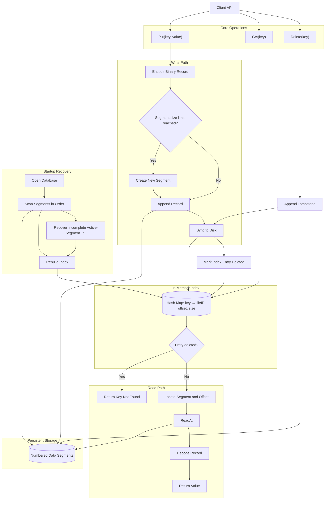

# Bitcask-Go

A Bitcask-inspired key-value storage engine built from scratch in Go to explore database internals, append-only storage, indexing, recovery, and log compaction.

## 🚀 Features

- **Append-only storage** — Persists records in binary data files.
- **Segment rotation** — Rotates to a new data file when the configured segment size limit is reached (2 MiB by default).
- **Binary record encoding** — Stores keys and values with length-prefixed records.
- **In-memory hash index** — Maps keys to their latest record locations for efficient lookups.
- **Multi-segment index recovery** — Rebuilds the index by scanning data segments in order when the database opens.
- **Latest-write-wins semantics** — Ensures reads return the latest value written for a key.
- **Crash recovery** — Handles incomplete trailing records by truncating recoverable tails in the active segment.
- **Concurrent access** — Uses synchronization to coordinate concurrent reads and writes.
- **Log compaction** — Rewrites live records and removes obsolete versions to reclaim disk space.

## 🛠️ Tech Stack

- **Language:** Go
- **Storage:** Append-only binary data files
- **Index:** In-memory hash map
- **Concurrency:** Go synchronization primitives
- **Testing:** Go testing package and race detector

## 📂 Project Structure

```text
bitcask-go/
├── cmd/
│   └── bitcask/
│       └── main.go
├── internal/
│   └── storage/
│       ├── bitcask.go
│       ├── record.go
│       ├── storage_test.go
│       └── recovery_test.go
├── go.mod
├── .gitignore
└── README.md
```

*The structure above reflects the current project layout; adjust filenames if your repository differs.*

## ⚙️ Getting Started

### Prerequisites

- Go installed on your machine
- Git

### Clone the repository

```bash
git clone https://github.com/py3-coder/bitcask-go.git
cd bitcask-go
```

### Run the project

```bash
go run ./cmd/bitcask
```

### Run tests

```bash
go test ./...
```

Run the race detector to check for data races:

```bash
go test -race ./...
```

## 🧠 What I'm Learning

This project is a hands-on exploration of storage-engine internals, including:

- Binary record serialization and deserialization
- Append-only log-based storage
- Offset-based reads and in-memory indexing
- Segment rotation and multi-file management
- Startup recovery and index reconstruction
- Concurrent reads and writes
- Crash recovery and disk durability
- Log compaction and obsolete-record cleanup
- Storage-engine correctness and testing

## 🗺️ Roadmap

- [x] Append-only record storage
- [x] In-memory hash index
- [x] Multi-segment storage and rotation
- [x] Multi-segment index recovery
- [x] Incomplete trailing-record recovery
- [x] Concurrent reads and writes
- [x] Log compaction and obsolete-record cleanup
- [x] Tombstone-based deletion
- [ ] Crash-safe compaction and stronger recovery guarantees
- [ ] Benchmarks and performance testing

## ⚠️ Project Status

This is an experimental learning project, not a production-ready database.

Although the project implements segment rotation, index recovery, concurrency controls, and compaction, further work is needed to validate crash consistency, compaction failure handling, durability guarantees, and behavior under heavy concurrent workloads.


## 🏗️ Architecture



The database appends records to numbered data segments and maintains an in-memory hash index pointing to the latest record for each key. Reads use the index to locate the record on disk. Deletes append tombstones, while startup recovery reconstructs the index by scanning existing segments.

Compaction rewrites live records and removes obsolete versions. Crash-safe compaction and stronger recovery guarantees remain areas for further validation.


## 📚 Inspiration

Inspired by the [Bitcask storage model](https://riak.com/assets/bitcask-intro.pdf), with the goal of understanding database internals by implementing the core concepts from scratch.

---

**Built with Go, one storage-engine concept at a time.** 🚀